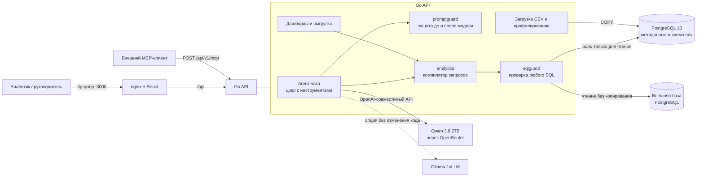
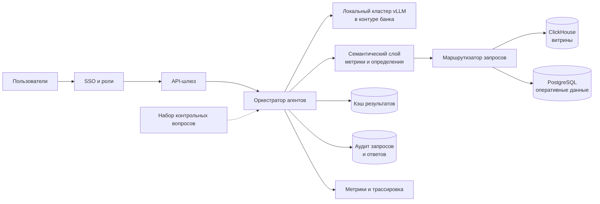

# Архитектура AI-Native BI

## Текущая архитектура



### Стек

| Слой | Технологии |
|---|---|
| Интерфейс | React 19, Vite 7, собственный SVG-движок графиков, nginx 1.29 |
| API | Go 1.27, chi, pgx, `log/slog` |
| Хранилище | PostgreSQL 18, миграции golang-migrate |
| Языковая модель | `qwen/qwen3.8-27b` через OpenRouter, порядок провайдеров задаёт `LLM_PROVIDER_ORDER` |
| Запасной вариант без модели | Детерминированное описание данных по профилю каталога |
| Развёртывание | Docker Compose: `postgres`, `migrate`, `api`, `frontend`, опционально `ollama` |

Все внешние зависимости открытые. Единственное обращение платформы в интернет — к API модели на `openrouter.ai`. С локальной моделью внешних обращений нет.

### Как проходит вопрос

1. `promptguard` проверяет вопрос до модели: приёмы инъекции и просьбы изменить данные отклоняются сразу.
2. Агент получает описание датасетов. Все строки из пользовательских данных проходят через фильтр `dataFilter.clean`.
3. Модель вызывает типизированные инструменты, видит результат или ошибку и исправляет параметры. Цикл ограничен `AGENT_MAX_STEPS`.
4. `core/analytics` собирает SQL с параметрами `$n` по белым спискам каталога. `sqlguard` проверяет запрос, запрос выполняется от роли только для чтения.
5. `core/chart` выбирает тип графика по форме результата и проверяет вариант, предложенный моделью.
6. Проверка ответа после модели ищет утечку промпта, вырезает ссылки и разметку, помечает числа без расчёта.
7. Интерфейс получает шаги событиями SSE и показывает ответ: текст, главное число, график, таблицу.

### Ключевые решения

| Решение | Почему | Документ |
|---|---|---|
| Модель не пишет SQL, а вызывает инструменты | Запрос нельзя испортить или подменить текстом из данных. Модель видит промежуточные результаты и исправляет ошибки | [ADR 0002](docs/adr/0002-agent-s-instrumentami-vmesto-sql.md) |
| Несколько слоёв защиты от prompt injection | Ни один фильтр текста не надёжен сам по себе, поэтому проверки стоят до модели, в данных и после модели | [ADR 0003](docs/adr/0003-zashchita-ot-prompt-injection.md) |
| Два происхождения датасета: `uploaded` и `attached` | Внешнюю базу платформа только читает и не копирует | [ADR 0001](docs/adr/0001-podklyuchenie-k-vneshnim-bazam.md) |
| График выбирается по форме результата | Модель не может навязать нерабочий график | `internal/core/chart` |
| Статистика считается в коде | Сезонность, корреляции, прогноз и сценарии «что если» не зависят от арифметики модели | `internal/core/analytics/stats.go` |
| Платформа работает без модели | Сбой модели не обрывает диалог: агент описывает данные по профилю каталога | `internal/features/chat/service` |

### Структура кода

```
cmd/api/             сборка зависимостей и запуск
internal/core/       domain, analytics, sqlguard, promptguard, chart, export, llm, repository, transport
internal/features/   datasets, sources, chat, dashboards, query, providers, mcp
frontend/src/        app, shared, features (chat, datasets, sources, dashboards)
migrations/          схема метаданных
docs/adr/            обоснование решений
```

Бэкенд и интерфейс разделены на одинаковые вертикали. Зависимости собираются вручную в `cmd/api/main.go`, интерфейсы объявляются на стороне потребителя.

### Ограничения текущей версии

- Демонстрационная модель работает через облачный шлюз OpenRouter. Запуск с локальной моделью предусмотрен, но весь набор вопросов на ней не прогонялся (см. [Criteria.md](Criteria.md)).
- ClickHouse не реализован: из «PostgreSQL или ClickHouse» выбран PostgreSQL.
- Один SQL-запрос не соединяет таблицы разных источников.
- В платформе нет разграничения пользователей и ролей.

## Идеальная архитектура

Эта часть описывает развитие решения для промышленной эксплуатации. Перечисленного здесь в коде пока нет.



| Направление | Что меняется | Зачем |
|---|---|---|
| Модель | Локальный кластер vLLM в контуре банка | Данные не покидают контур, полное соответствие критериям №9 и №10 |
| Источники | Коннектор ClickHouse и федеративные запросы | Большие витрины и соединение таблиц из разных баз |
| Семантический слой | Единые определения показателей с владельцами | Одинаковая «выручка» у всех пользователей и в каждом ответе |
| Безопасность | SSO, роли на уровне строк и колонок, маскирование персональных данных | Работа с данными разной конфиденциальности |
| Надёжность | Очередь задач агента, кэш результатов, горизонтальное масштабирование API | Устойчивость при большом числе одновременных пользователей |
| Контроль качества | Регулярный прогон контрольных вопросов при смене модели или промпта | Изменения качества заметны до выката |
| Наблюдаемость | OpenTelemetry, журнал аудита | Разбор ошибок и контроль стоимости |
